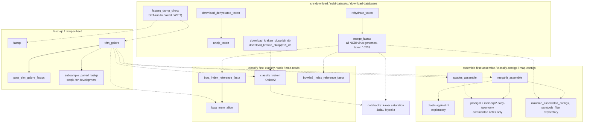

# viral-pangenome-discovery

[](https://github.com/cjprybol/viral-pangenome-discovery/actions/workflows/dryrun.yml)

Snakemake modules and Julia notebooks for finding viral sequence in environmental shotgun metagenomes (air, soil/compost, wastewater, and human stool) from public SRA and HMP data.
The project compared two routes to a viral pangenome: **classify first** (label reads as viral with Kraken2 or by mapping to all NCBI virus genomes, then assemble) and **assemble first** (assemble each sample with MEGAHIT or metaSPAdes, then classify the contigs with BLAST or MMseqs2).
Julia notebooks built on [Mycelia](https://github.com/cjprybol/Mycelia) estimate k-mer saturation of known viral diversity in the NCBI reference set and in reads classified as viral.

> **Status:** research code from 2022, not actively maintained.
> The modules were run step by step on individual samples during development; they are not chained into a single end-to-end workflow, and two modules (`classify-contigs`, `map-contigs`) are exploratory, with hard-coded paths.
> See [Known limitations](#known-limitations).

## Workflow

Each box is a Snakemake rule; each grouping is one Snakefile in `snakemake/`.
Modules are run separately, passing paths between them with `--config` (solid arrows are dependencies Snakemake tracks within a module; dashed arrows are hand-offs between modules).



## Inputs and outputs

| Module | Config keys | Inputs | Outputs |
| --- | --- | --- | --- |
| `sra-download` | `srr_identifier`, `directory` | SRA accession (network) | `<directory>/<SRR>/<SRR>_{1,2}.fastq.gz` |
| `fastq-qc` | `directory`, `sample_id`, `forward`, `reverse` | paired `.fastq.gz` | FastQC reports before and after trimming; Trim Galore `*_val_{1,2}.fq.gz` |
| `fastq-subset` | `forward`, `reverse`, `sampling_rate` | paired FASTQ | subsampled FASTQ next to the inputs |
| `classify-reads` | `forward`, `reverse`, `kraken_db`, `out_directory`, `sample_id` | trimmed reads, Kraken2 database | Kraken2 report, classified reads (see limitations) |
| `map-reads` | `reference_fasta`, `forward`, `reverse` | reference FASTA, trimmed reads | bwa index, filtered BAM; bowtie2 index |
| `assemble` | `forward`, `reverse`, `out_directory` | trimmed reads | `<out_directory>/megahit/`, `<out_directory>/spades/` (not declared as rule outputs) |
| `ncbi-datasets` | `taxon`, `source` | NCBI Datasets (network) | `data/taxon_<taxon>.<source>/<taxon>.fna` |
| `download-databases` | `out_directory` | network | unpacked Kraken2 PlusPFP 8 GB / 16 GB databases |

Dataset accession lists used during development are in `metadata/`: air metagenomes (BioProject PRJNA421162, 594 runs), soil and compost metagenomes from the Mt. Pleasant Research Farm, Cornell University (12 runs), wastewater metagenomes (PRJNA875025, 188 runs), and an HMP stool-sample manifest.

## Quick start

```bash
git clone https://github.com/cjprybol/viral-pangenome-discovery.git
cd viral-pangenome-discovery

# full tool environment (bioconda + conda-forge)
mamba env create --file environment.yml
conda activate viral-pangenome-discovery

# check a module resolves against the bundled synthetic example, without running anything
snakemake --snakefile snakemake/fastq-qc.snakemake.py \
    --configfile config/examples/fastq-qc.yaml \
    --cores 1 --dry-run all

# run it for real on your own reads: copy and edit the example config
snakemake --snakefile snakemake/fastq-qc.snakemake.py \
    --configfile my-sample.yaml --use-conda --cores 4 all
```

Every module has an example config in `config/examples/`.
The download modules (`sra-download`, `ncbi-datasets`, `download-databases`) fetch large public data when run without `--dry-run`; the NCBI virus set and the Kraken2 databases are several GB.

### Tests

`tests/test_dryrun.sh` dry-runs every parameterized module against the example configs and the synthetic inputs in `tests/data/` (a few hundred random reads; regenerate with `python3 tests/make_synthetic_data.py`), checks the two exploratory modules parse, and summarizes `snakemake --lint` findings.
It needs only Snakemake, not the bioinformatics tools:

```bash
python3 -m venv .venv && .venv/bin/pip install --requirement tests/requirements.txt
SNAKEMAKE=.venv/bin/snakemake bash tests/test_dryrun.sh
```

The dry-run confirms rule wiring and config handling only; it does not execute any tool or check biological results.
Lint findings (style issues such as missing `log:` directives and path composition with `+`) are reported but do not fail the test unless `--strict-lint` is passed.

## Repository layout

```text
snakemake/            one Snakefile per pipeline stage (see table above)
snakemake/archive/    earlier single-Snakefile version with per-sample hard-coded rules
notebooks/            Julia notebooks: k-mer saturation of viral diversity (reference and
                      observed), merging NCBI FASTAs, SRA prefetch, pulling HMP data
metadata/             SRA / HMP accession lists and run metadata for the datasets used
config/examples/      example config for each module
tests/                dry-run smoke test and synthetic inputs
docs/notes.md         original 2022 working notes (study design, dataset selection)
environment.yml       conda environment with all command-line tools
Project.toml          Julia dependencies for the notebooks
apt.txt, postBuild,   repo2docker / Binder build files
build-command.sh
blast-header.txt      BLAST tabular output column names
```

## Known limitations

- **No end-to-end workflow.** Modules are run one at a time, with paths copied between them via `--config`.
- **`assemble` rules declare no outputs**, so Snakemake cannot track or skip completed assemblies.
- **`ncbi-datasets`:** `rehydrate_taxon` does not declare a dependency on `unzip_taxon`, so requesting `merge_fastas` on a fresh checkout schedules only rehydrate and merge; run `unzip_taxon` first.
- **`classify-reads`** passes the same path to Kraken2's `--output` and `--report`, so the per-read output and the summary report collide; give them separate paths before reusing it.
- **`map-reads`** defines bowtie2 indexing but no bowtie2 alignment rule.
- **`classify-contigs` and `map-contigs`** are exploratory: rules use hard-coded paths for one sample (SRR6399459), and the MMseqs2 and Prodigal commands are kept as comments recording what was tried.
- Shell commands use `` `nproc` ``, which is not available on macOS without GNU coreutils.
- The notebooks target Julia 1.6/1.7 and load Mycelia from a sibling checkout (`../../Mycelia`); the Mycelia API has changed since 2022.
- Centrifuge and Kaiju were evaluated and dropped (see comments in `download-databases` and `classify-reads`).

## Citation and contact

No paper accompanies this repository.
If you use it, please cite the repository URL and link to [Mycelia](https://github.com/cjprybol/Mycelia) for the k-mer analysis code.

Cameron Prybol — [github.com/cjprybol](https://github.com/cjprybol)
